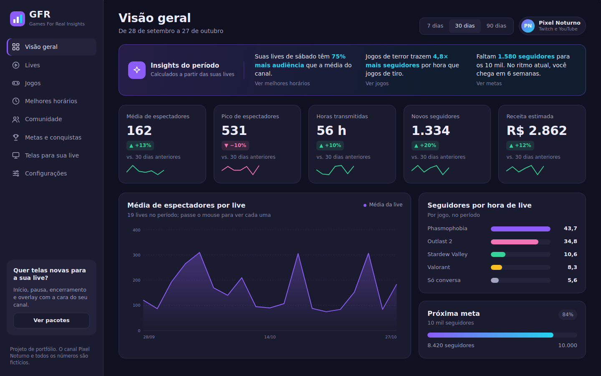
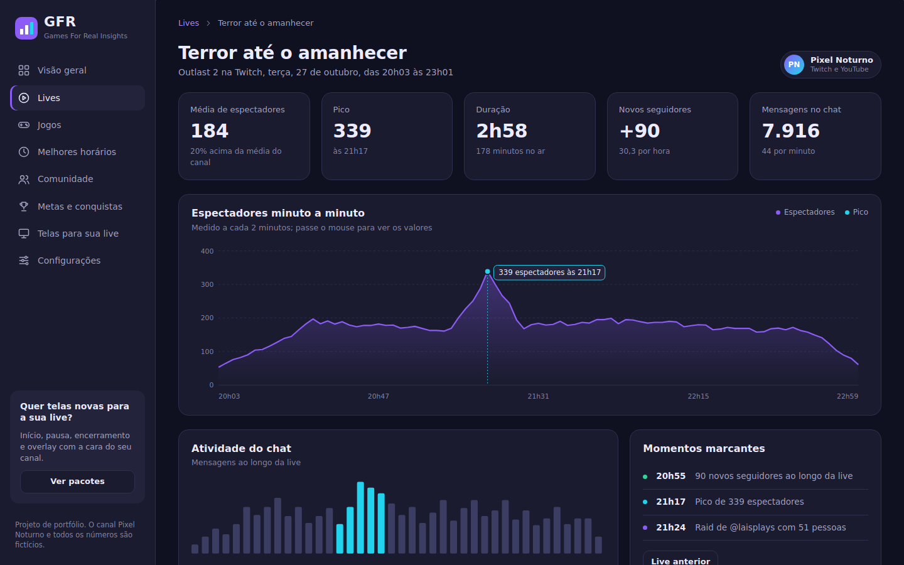
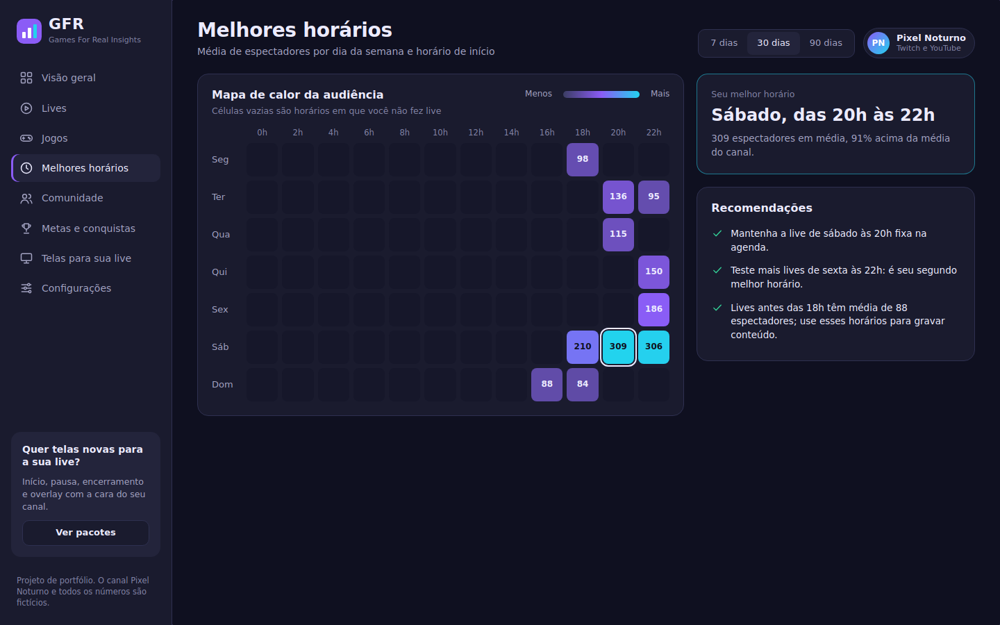
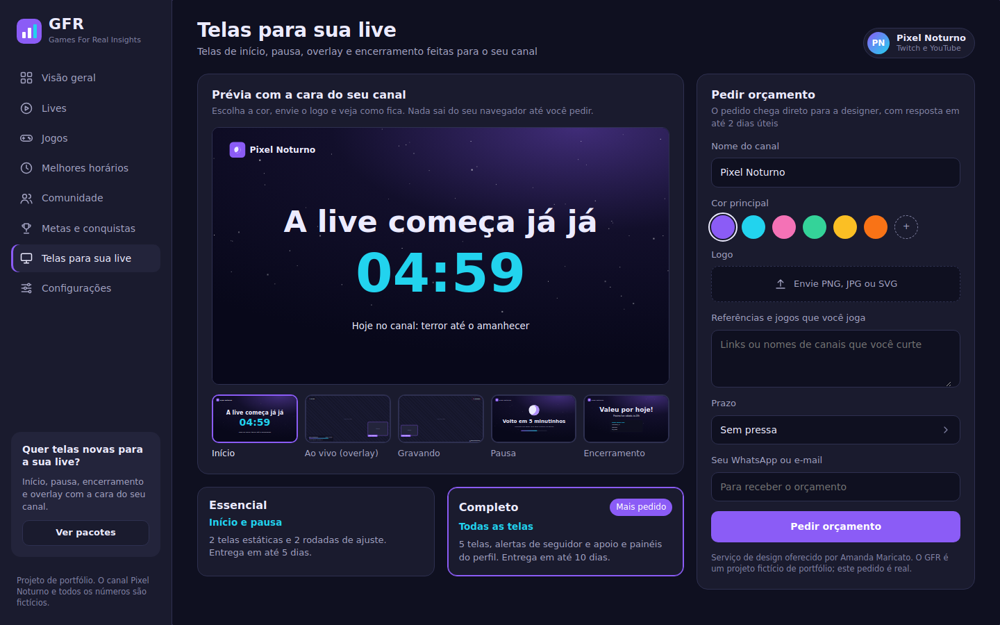
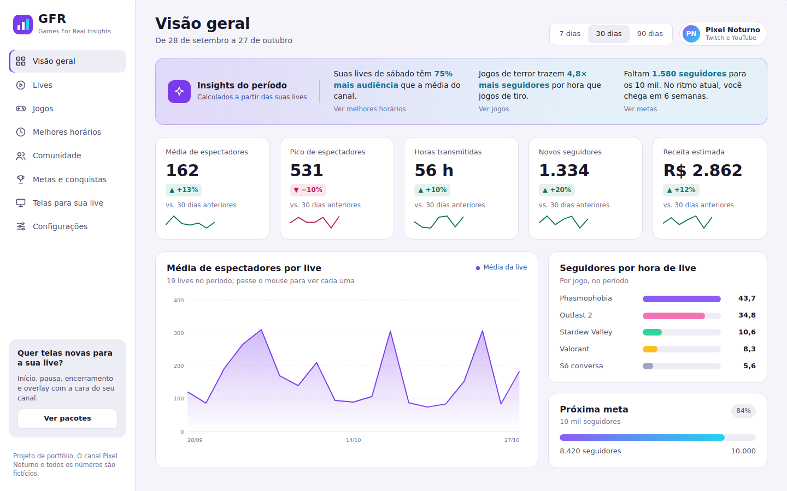
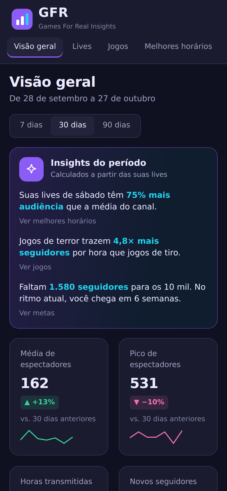

# GFR: Games For Real Insights

Painel de métricas para streamers: mostra como cada live, jogo e horário se saiu e transforma os números em recomendações práticas. Projeto de portfólio de UX/UI e front-end.

Site: https://gfrinsights.netlify.app/

> O canal **Pixel Noturno**, os apoiadores e todas as métricas são **fictícios**, gerados por script. O GFR não tem ligação com a Twitch, o YouTube ou a Kick.



**Demonstração:** (https://gfrinsights.netlify.app/)
## O problema

Streamers pequenos e médios têm os números espalhados entre as plataformas e não conseguem comparar jogos, dias e horários entre si. O GFR junta tudo num lugar só e responde perguntas diretas: em que dia e horário vale a pena fazer live? Qual jogo traz mais seguidores? Quanto falta para a próxima meta?

## Funcionalidades

- **Visão geral** com indicadores do período (7, 30 ou 90 dias), comparação com o período anterior e gráfico de audiência por live.
- **Insights automáticos em texto**, calculados a partir dos dados. Exemplo: "Jogos de terror trazem 4,8× mais seguidores por hora que jogos de tiro".
- **Lives** com busca, filtros por jogo e plataforma, ordenação por coluna, paginação e exportação em CSV.
- **Detalhe da live** com a curva de espectadores minuto a minuto, o pico marcado, atividade do chat e momentos marcantes.
- **Jogos**: comparativo de audiência, seguidores por hora e retenção.
- **Melhores horários**: mapa de calor de dia da semana × horário, com recomendações.
- **Comunidade**: crescimento de seguidores e maiores apoiadores.
- **Metas e conquistas** no estilo achievements de jogo.
- **Telas para sua live**: prévia ao vivo das telas de início, overlay, gravando, pausa e encerramento, personalizada com a cor, o nome e o logo do canal. O pedido de orçamento sai pronto para WhatsApp ou e-mail.
- Tema escuro e claro, layout responsivo e navegação por teclado.

| Detalhe da live | Melhores horários |
| --- | --- |
|  |  |

| Telas para sua live | Tema claro |
| --- | --- |
|  |  |



## Tecnologias

- [React 18](https://react.dev) com [Vite](https://vitejs.dev)
- [React Router](https://reactrouter.com) para as rotas, com cada tela carregada sob demanda (`React.lazy`)
- CSS puro com variáveis para os temas claro e escuro
- Gráficos desenhados em SVG, sem biblioteca de gráficos
- Dados simulados gerados por um script em Node

## Decisões de design e código

- **Números viram frases.** Os insights são o diferencial do painel: em vez de só desenhar gráficos, o app compara dias, gêneros e ritmo de crescimento e escreve a conclusão.
- **Dados com tendência real.** O script de dados planta padrões de propósito (sábado à noite e jogos de terror rendem mais), para que os insights encontrem algo verdadeiro para dizer.
- **Variação nunca só por cor.** Toda alta ou queda aparece com seta e sinal (▲ +12%), pensando em daltonismo.
- **Gráficos próprios em SVG.** Escala do eixo, marcação de pico e balão ao passar o mouse foram feitos à mão, sem dependência extra.
- **Formato brasileiro.** Números como 1.234, datas dd/mm e valores em R$; o CSV usa `;` para abrir direto no Excel.

## Como rodar

Você precisa do [Node.js](https://nodejs.org) 18 ou mais recente.

```bash
npm install      # instala as dependências
npm run dev      # abre em http://localhost:5173
```

Outros comandos:

```bash
npm run build    # gera a versão de produção em dist/
npm run preview  # testa a versão de produção
npm run data     # gera de novo os dados fictícios em src/data/lives.json
```

## Estrutura

```text
scripts/
  generate-data.js     gera os dados fictícios do canal
src/
  components/          Layout, TopBar, LineChart, InsightStrip, StreamScreen...
  pages/               uma página por rota
  lib/                 cálculo das métricas, insights e formatação
  hooks/               período, tema e plataformas
  data/                JSON gerado pelo script
  styles/              estilos globais e temas
  config.js            contato que recebe os pedidos de telas
```


## Autora

**Amanda Maricato - TORIM **, UX/UI designer e desenvolvedora front-end.
LinkedIn: linkedin.com/in/amanda-maricato-175b1b1b5/
Behance: https://www.behance.net/amandamaricato
